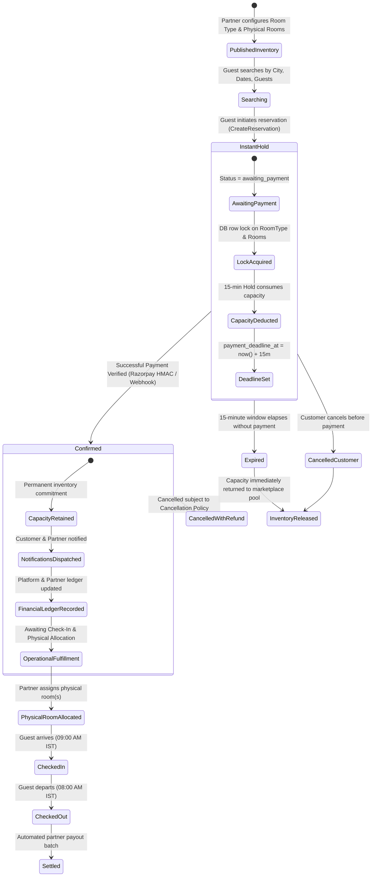

# TIJUM — Booking Lifecycle Architecture
## Automatic Booking Confirmation via Real-Time Inventory Control and Payment Verification

> **DOCUMENT ID:** `TIJUM-DOC-BAC-01`  
> **STATUS:** Complete & Production Verified  
> **SCOPE:** Platform-wide Reservation Lifecycle (Web, Mobile, REST API, Database, Operations)

---

## 1. Executive Summary & Core Principle

TIJUM is a food-inclusive accommodation marketplace where booking certainty, guest experience, and inventory integrity are paramount. 

The previous booking architecture contained a structural defect inherited from traditional peer-to-peer inquiry models: when a customer requested an available room type, the reservation was placed in a `PendingOwnerConfirmation` status, requiring the property owner to manually log in, review, and accept the booking request before the customer could proceed to payment.

This manual gate caused significant friction:
- Customer drop-off during the waiting window.
- Inability to guarantee inventory while waiting for owner review.
- Double-booking risks and unpredictable booking completion times.
- Degradation of mobile checkout conversions.

**The Corrected Architectural Principle:**
$$\text{Available Inventory} + \text{Valid Customer Booking} + \text{Successful Payment Verification} = \mathbf{Automatically\ Confirmed\ Reservation}$$

There is **zero owner-approval dependency** in the customer booking flow. Accommodation owners manage availability, pricing, meal inclusions, rules, and physical room allocations; however, they cannot reject, review, or gate a legitimate guest booking for published, available inventory.

---

## 2. End-to-End Booking Lifecycle

---

## 3. Detailed State Progression & Transitions

| State Enum | Value | Consumes Capacity | Trigger / Actor | Next Allowed States | Architectural Role |
| :--- | :--- | :---: | :--- | :--- | :--- |
| `AwaitingPayment` | `awaiting_payment` | **Yes** | Customer (`CreateReservation`) | `Confirmed`, `ExpiredPaymentWindow`, `CancelledCustomer` | Temporary 15-minute inventory hold while checkout is completed. |
| `Confirmed` | `confirmed` | **Yes** | System / Backend (`confirmPaid`) | `CheckedIn`, `CancelledCustomer`, `CancelledPlatform`, `Relocated` | Guaranteed booking. Immediate guest voucher and partner fulfillment notice. |
| `CheckedIn` | `checked_in` | **Yes** | Partner (`CheckInReservation`) | `CheckedOut` | Guest checked in on or after 09:00 AM IST. |
| `CheckedOut` | `checked_out` | **No** | Partner (`CheckOutReservation`) | `Completed` | Stay complete at 08:00 AM IST. Eligible for settlement. |
| `ExpiredPaymentWindow`| `expired_payment_window`| **No**| Scheduler / System (`ReconcileExpiredReservations`) | *Terminal* | Unpaid after 15 min. Inventory instantly restored. |
| `CancelledCustomer` | `cancelled_customer` | **No** | Customer (`CancelReservation`) | *Terminal* | Customer abandoned prior to pay or cancelled post-pay. |
| `PendingOwnerConfirmation` *(Legacy)* | `pending_owner_confirmation` | **Yes** | *Historical only* (Never emitted by new code) | `AwaitingPayment`, `DeclinedOwner`, `ExpiredOwnerReview` | Preserved strictly for historical auditability of pre-cutover rows. |
| `DeclinedOwner` *(Legacy)* | `declined_owner` | **No** | *Historical only* (Throws 422 on new bookings) | *Terminal* | Preserved strictly for audit logs. |

---

## 4. Key Architectural Guarantees

1. **Instant Reservation Placement:**
   - The customer selects dates, room types, guest count, and meal package.
   - Upon clicking "Book Now" or calling `POST /api/v1/customer/reservations`, the system immediately executes `CreateReservation` inside an InnoDB transaction with pessimistic row-level locking (`lockForUpdate()`).
   - The reservation is saved directly with status `AwaitingPayment`, a `submitted_at` timestamp, and `payment_deadline_at = now()->addMinutes(15)`.

2. **Immediate Capacity Consumption (The Hold):**
   - Because `ReservationStatus::AwaitingPayment->consumesCapacity() === true`, the room inventory is deducted from available capacity immediately.
   - No other customer can book the held room during this 15-minute window.
   - The customer does not compete with other buyers during checkout.

3. **Autonomous Payment Verification:**
   - Payment is collected via Razorpay checkout (UPI, Card, Net Banking).
   - Upon verification via client return (`POST /reservations/{ref}/verify`) or asynchronous server webhook (`POST /api/v1/payments/razorpay/webhook`), `ReservationLifecycle::confirmPaid()` is executed inside an atomic transaction.
   - The status updates directly to `Confirmed`, generating invoice and voucher records and notifying both customer and property partner.

4. **Zero Owner Intervention for Booking Confirmation:**
   - Property partners receive an informative, operational push/email/SMS notification: *"New confirmed booking [REF] for Room Type [X] checking in on [DATE]"*.
   - Partners have no option to "Reject" or "Approve" legitimate bookings.
   - The partner portal provides tools exclusively for operational fulfillment: assigning physical room numbers (`allocateRoom`), handling early arrivals, and managing check-in/checkout.

5. **Legacy Protection & Non-Disruption:**
   - Historical bookings created under prior versions retain their audit trails.
   - Legacy endpoints (`POST /owner/reservations/{ref}/confirm`, `POST /api/v1/owner/reservations/{ref}/accept`) reject calls for modern bookings with standard machine-readable error `OWNER_APPROVAL_NOT_REQUIRED` (HTTP 422).
