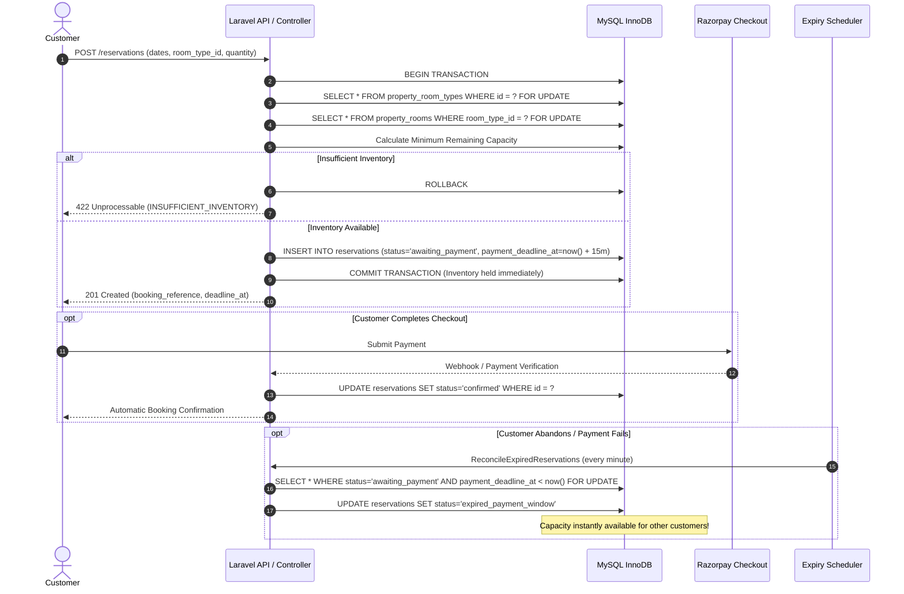

# TIJUM — Inventory Availability and Hold Architecture
## Hierarchical Inventory, Derived Capacity Calculations, and Pessimistic 15-Minute Reservation Holds

> **DOCUMENT ID:** `TIJUM-DOC-BAC-02`  
> **STATUS:** Complete & Production Verified  
> **SCOPE:** Capacity Domain, Availability Engine, Locking & Concurrency Control

---

## 1. Domain Model Hierarchy

TIJUM enforces a clean three-tier inventory model:

$$\text{Property} \longrightarrow \text{Property Room Type} \longrightarrow \text{Property Rooms (Physical Inventory)}$$

```
+-------------------------------------------------------------------+
|                            PROPERTY                               |
| (Managed by Owner, Verified by Admin, Published in City)          |
+-------------------------------------------------------------------+
                                  |
                                  | 1 : N
                                  v
+-------------------------------------------------------------------+
|                       PROPERTY ROOM TYPE                          |
| (Commercial listing: e.g. "Standard Double AC with 3 Meals",      |
|  Total Inventory, Max Guests per Room, Daily Rate Minor)          |
+-------------------------------------------------------------------+
                                  |
                                  | 1 : N
                                  v
+-------------------------------------------------------------------+
|                         PROPERTY ROOM                             |
| (Physical Units: "Room 101", "Room 102", "Room 201",              |
|  Status: Active / Maintenance / Inactive)                         |
+-------------------------------------------------------------------+
```

### Critical Architectural Rules
1. **No Bed-Level Tracking:** TIJUM books **rooms**, not individual beds. Even in shared PG/Hostel configurations, the unit of inventory sold and allocated is the room or room occupancy capacity. There are no bed entities or bed IDs in the schema.
2. **Physical Rooms Define Ceiling:** The total inventory for any `PropertyRoomType` is determined by the count of active `PropertyRoom` records associated with that room type.
3. **Stay Timing Invariant:** 
   - Check-in: **09:00 AM IST** on check-in date.
   - Checkout: **08:00 AM IST** on checkout date.
   - Because checkout (08:00 AM) precedes check-in (09:00 AM), a room departing on Date $D$ is completely available for another guest arriving on Date $D$ without overlap conflict.

---

## 2. Derived Capacity Calculation Formula

TIJUM calculates real-time room availability without denormalized counters or fragile cache invalidation bugs.

For any given `PropertyRoomType` over a date range $[D_{\text{start}}, D_{\text{end}}]$ with requested room quantity $Q$:

### Step 1: Active Physical Units
$$C_{\text{physical}} = \operatorname{COUNT}\Big( \text{PropertyRoom} \mid \text{room\_type\_id} = R \land \text{is\_active} = \text{true} \Big)$$

### Step 2: Active Property Blocks
Check if the property or room type has owner/admin maintenance blocks:
$$B_{\text{blocked}} = \operatorname{COUNT}\Big( \text{PropertyAvailabilityBlock} \mid \text{overlaps}([D_{\text{start}}, D_{\text{end}}]) \Big)$$
If blocked, available inventory is forced to 0.

### Step 3: Overlapping Capacity-Consuming Reservations
$$\mathcal{S}_{\text{consuming}} = \Big\{ \text{PendingOwnerConfirmation},\, \text{AwaitingPayment},\, \text{Confirmed},\, \text{CheckedIn} \Big\}$$

For each day $d \in [D_{\text{start}}, D_{\text{end}} - 1]$:
$$R_{\text{booked}}(d) = \sum \Big\{ \text{quantity} \mid \text{status} \in \mathcal{S}_{\text{consuming}} \land \text{check\_in} \le d < \text{checkout} \Big\}$$

### Step 4: Daily Remaining Capacity & Stay Minimum
$$\text{Available}(d) = C_{\text{physical}} - R_{\text{booked}}(d)$$
$$\text{Minimum Remaining Capacity} = \min_{d} \Big( \text{Available}(d) \Big)$$

The stay is bookable if and only if:
$$\text{Minimum Remaining Capacity} \ge Q$$

---

## 3. The 15-Minute Reservation Hold Engine

To avoid race conditions and double-bookings while a customer enters credit card details or authenticates with UPI, TIJUM implements an integrated hold mechanism directly within the `reservations` table:



### Why a Dedicated Holds Table is NOT Needed
In TIJUM, an `awaiting_payment` reservation row **is** the inventory hold:
1. `ReservationStatus::AwaitingPayment->consumesCapacity() === true`.
2. As soon as the transaction commits, the reservation row exists in MySQL with an indexed `check_in_date`, `checkout_date`, and `property_room_type_id`.
3. Every subsequent call to `ReservationAvailabilityService::stayCapacity()` queries active consuming statuses, immediately seeing the hold.
4. Holding state in the same table as the reservation eliminates multi-table sync anomalies, duplicate deadlocks, and orphan hold rows.

---

## 4. Pessimistic Concurrency Control (InnoDB Row Locking)

Under high concurrency (e.g. flash sales or last-available room scenarios), multiple users may attempt to hold the final room simultaneously.

TIJUM guarantees safety via `lockForUpdate()` in `CreateReservation.php`:

```php
return DB::transaction(function () use ($user, $property, $roomType, $checkIn, $checkout, $roomsCount, $guestCount, $mealPlan, $specialRequests, $submissionToken) {
    // 1. Acquire pessimistic locks on Property, Room Type, and all constituent Physical Rooms
    $lockedProperty = Property::query()->where('id', $property->id)->lockForUpdate()->firstOrFail();
    $lockedRoomType = PropertyRoomType::query()->where('id', $roomType->id)->lockForUpdate()->firstOrFail();
    PropertyRoom::query()->where('property_room_type_id', $roomType->id)->lockForUpdate()->get();

    // 2. Re-evaluate remaining capacity with serialized locks acquired
    $capacity = $this->availability->stayCapacity(
        $lockedRoomType,
        $checkIn->toDateString(),
        $checkout->toDateString(),
        $roomsCount
    );

    if ($capacity['minimum_remaining'] < $roomsCount) {
        throw ValidationException::withMessages([
            'rooms_count' => 'The requested room type no longer has sufficient availability for the selected dates.',
        ]);
    }

    // 3. Atomically create the reservation in AwaitingPayment status
    $reservation = new Reservation();
    $reservation->forceFill([
        'status' => ReservationStatus::AwaitingPayment,
        'submitted_at' => CarbonImmutable::now(),
        'payment_deadline_at' => CarbonImmutable::now()->addMinutes(15),
        // ... pricing & guest details
    ]);
    $reservation->save();

    return $reservation;
}, 3);
```

### Formal Proof of Zero Overbooking
1. Thread A and Thread B request the last remaining room at the exact same millisecond.
2. Thread A acquires `lockForUpdate()` on `property_room_types` row ID $X$.
3. Thread B enters `WAITING FOR ROW LOCK` on the same row.
4. Thread A executes capacity math: `minimum_remaining = 1 >= 1` (valid). Thread A creates `AwaitingPayment` reservation and commits.
5. Thread A's transaction commits, releasing the lock.
6. Thread B unblocks, reads the freshly committed row state. Because Thread A's row now has `status = 'awaiting_payment'`, `minimum_remaining` calculates to `0 < 1`.
7. Thread B immediately throws `ValidationException` (`422 Unprocessable Entity`).
8. Zero overbooking occurs. Verified by automated multi-connection MySQL concurrency tests (`MySqlInstantBookingConcurrencyTest`).
