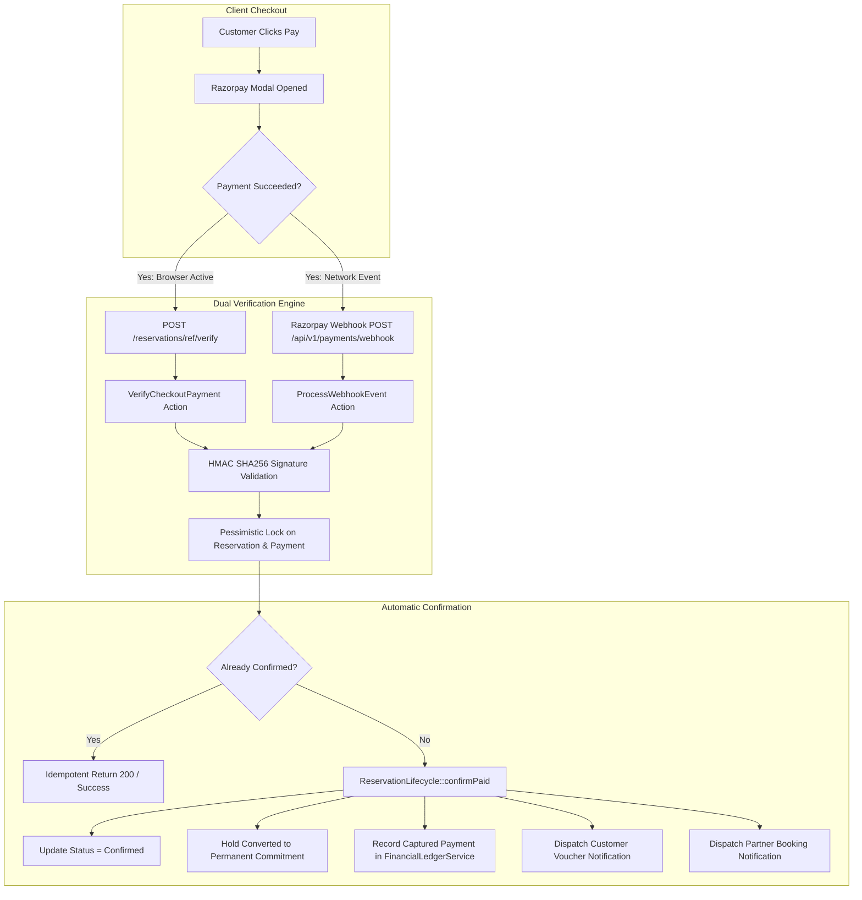

# TIJUM — Payment and Automatic Confirmation Architecture
## Dual-Path Payment Verification, Razorpay HMAC Validation, and Instant Ledger Recording

> **DOCUMENT ID:** `TIJUM-DOC-BAC-03`  
> **STATUS:** Complete & Production Verified  
> **SCOPE:** Payment Engine, Webhook Processing, Lifecycle Confirmation & Financial Ledger

---

## 1. Architectural Overview

Once a customer holds a room (`status = awaiting_payment`), they have 15 minutes to complete payment via Razorpay.

The confirmation engine is completely autonomous and event-driven:
$$\mathbf{Backend\ Payment\ Verification} \implies \mathbf{Automatic\ Transition\ to\ Confirmed}$$

There are two parallel, redundant verification paths that guarantee no booking is lost due to client disconnects, browser crashes, or network timeouts:

1. **Path A — Direct Client Verification:** Customer completes Razorpay modal $\to$ Browser sends `razorpay_order_id`, `razorpay_payment_id`, and `razorpay_signature` to `POST /reservations/{ref}/verify`.
2. **Path B — Server-to-Server Webhook:** Razorpay sends an asynchronous HTTPS webhook event (`order.paid` or `payment.captured`) with HMAC SHA-256 signature in `X-Razorpay-Signature` header to `POST /api/v1/payments/razorpay/webhook`.



---

## 2. Cryptographic Verification & HMAC Validation

To prevent tampering or forged payment confirmations, the backend performs cryptographic signature verification using the merchant secret before any state change.

### Client Callback HMAC Verification:
```php
$expectedSignature = hash_hmac(
    'sha256',
    $razorpayOrderId . '|' . $razorpayPaymentId,
    config('services.razorpay.key_secret')
);

if (! hash_equals($expectedSignature, $razorpaySignature)) {
    throw ValidationException::withMessages(['payment' => 'Invalid payment signature.']);
}
```

### Webhook Signature Verification:
The incoming raw payload is verified against the webhook secret:
```php
$expectedWebhookSignature = hash_hmac(
    'sha256',
    $rawPayload,
    config('services.razorpay.webhook_secret')
);

if (! hash_equals($expectedWebhookSignature, $receivedWebhookSignature)) {
    return response()->json(['error' => 'Invalid webhook signature.'], 400);
}
```

---

## 3. Idempotent Confirmation Engine (`confirmPaid`)

In high-concurrency environments, Path A (Browser Redirect) and Path B (Webhook) often arrive within fractions of a second of each other. 

TIJUM guarantees complete idempotency in `app/Actions/Reservations/ReservationLifecycle.php`:

```php
public function confirmPaid(Reservation $reservation, ?ReservationPayment $payment = null): Reservation
{
    return DB::transaction(function () use ($reservation, $payment) {
        $locked = Reservation::query()->where('id', $reservation->id)->lockForUpdate()->firstOrFail();

        // 1. Idempotency Check: If already confirmed, safely return without re-processing
        if ($locked->status === ReservationStatus::Confirmed) {
            return $locked;
        }

        // 2. Validate current state allows confirmation
        if ($locked->status !== ReservationStatus::AwaitingPayment && $locked->status !== ReservationStatus::PendingOwnerConfirmation) {
            throw ValidationException::withMessages([
                'reservation' => "Reservation cannot be confirmed from status: {$locked->status->value}",
            ]);
        }

        // 3. Transition status and record confirmation timestamp
        $locked->status = ReservationStatus::Confirmed;
        $locked->confirmed_at = CarbonImmutable::now();
        $locked->save();

        // 4. Record captured payment in the platform financial ledger
        if ($payment !== null) {
            $ledger = app(FinancialLedgerService::class);
            $ledger->recordCapturedPayment($payment, $locked);
        }

        // 5. Dispatch multi-channel notifications
        $this->notifications->send(
            $locked->user,
            'reservation.confirmed',
            [
                'reservation_reference' => $locked->booking_reference,
                'property_name' => $locked->property->name,
                'check_in_date' => $locked->check_in_date->format('d M Y'),
                'checkout_date' => $locked->checkout_date->format('d M Y'),
            ]
        );

        $this->notifications->send(
            $locked->property->owner,
            'partner.reservation_confirmed',
            [
                'reservation_reference' => $locked->booking_reference,
                'property_name' => $locked->property->name,
                'room_type_name' => $locked->roomType->name,
                'check_in_date' => $locked->check_in_date->format('d M Y'),
                'rooms_count' => $locked->rooms_count,
                'guest_count' => $locked->guest_count,
            ]
        );

        return $locked;
    }, 3);
}
```

---

## 4. Financial Ledger Integration

When `confirmPaid()` executes, the financial integrity of the marketplace is recorded immediately via `FinancialLedgerService::recordCapturedPayment()`:

1. **Guest Payment Entry:** Credits the guest escrow account for the total booking amount in minor units (`amount_minor`).
2. **Platform Commission Calculation:** Calculates TIJUM commission based on the partner's active commission agreement.
3. **Partner Payable Accrual:** Accrues net payout to the partner's settlement balance, locked until stay completion (08:00 AM checkout date).
4. **GST / Tax Withholding:** Records applicable Tax Collected at Source (TCS) and Goods and Services Tax (GST) withholding entries according to Indian statutory regulations.

---

## 5. Notification Dispatch Matrix

| Event | Recipient | Channels | Content |
| :--- | :--- | :--- | :--- |
| `reservation.confirmed` | **Customer** | Push, Email, In-App | Confirmation voucher, property address, contact details, stay check-in instructions (09:00 AM IST), food inclusions. |
| `partner.reservation_confirmed` | **Property Owner** | Push, Email, SMS, In-App | Booking notification with guest name, dates, room type, guest count, and direct link to assign physical room numbers. |

**Key Operational Distinction:** The partner notification is purely informative and operational. There is no link or button to accept or decline the reservation.
