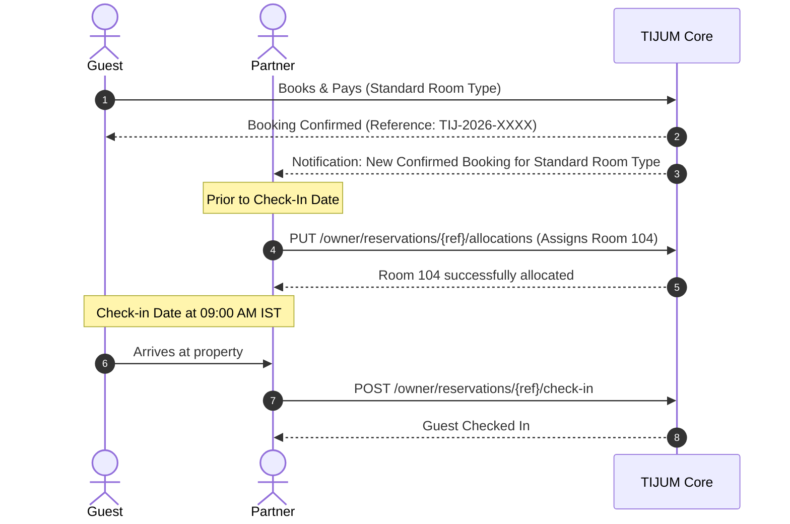

# TIJUM — Owner Portal Workflow Changes
## Transition from Approval Gatekeeper to Operational Fulfillment and Room Management

> **DOCUMENT ID:** `TIJUM-DOC-BAC-04`  
> **STATUS:** Complete & Production Verified  
> **SCOPE:** Web Owner Portal, Partner Mobile App, Operational Procedures

---

## 1. Paradigm Shift: Gatekeeper to Hospitality Host

In previous iterations of the TIJUM platform, property owners acted as synchronous gatekeepers. When a guest wanted to stay at a property, the owner received an urgent request and had to accept or decline it within a countdown window.

This model was removed in the Booking Architecture Correction. 

### The New Partner Operating Model:
- **Inventory Publishing is the Commitment:** By listing active rooms and publishing room types on TIJUM, the owner makes a binding commitment to host any guest who books and pays for that available inventory.
- **Operational Fulfillment:** Once a reservation is paid, it is automatically confirmed. The partner's responsibility begins at fulfillment: preparing rooms, allocating physical unit numbers, greeting guests at check-in (09:00 AM IST), serving agreed meals, and completing checkout (08:00 AM IST).

```
+----------------------------------------------------------------------------+
|                          OLD PARTNER WORKFLOW                              |
|  Guest Inquires -> Partner Receives Alert -> [Accept/Decline] -> Guest Pays|
+----------------------------------------------------------------------------+
                                     |
                                     v
+----------------------------------------------------------------------------+
|                          NEW PARTNER WORKFLOW                              |
|  Guest Books & Pays -> Auto-Confirmed -> Partner Receives Booking Notice   |
|                          |                                                 |
|                          v                                                 |
|  [Allocate Physical Room] -> [Check-In 09:00 AM] -> [Check-Out 08:00 AM]  |
+----------------------------------------------------------------------------+
```

---

## 2. Interface Modifications (Web & Mobile)

### A. Partner Web Dashboard (`resources/js/pages/owner/reservations/`)
1. **Queue Redesign:**
   - The "Action Required / Pending Approval" tab was removed.
   - Replaced by **"Confirmed Stays"**, **"Arriving Today"**, **"In-House"**, and **"Departing"**.
2. **Action Buttons Removed:**
   - Green "Accept Reservation" and Red "Decline Reservation" buttons were removed from all reservation listings and detail views.
3. **Room Allocation Highlighted:**
   - When a booking is confirmed, the action primary button is **"Assign Room"** (e.g. assigning physical Room 102 to John Doe).
   - Once assigned, physical room numbers are clearly displayed alongside guest contact information.
4. **Copy & Guidance:**
   - Informative notice added: *"All bookings on TIJUM are instantly confirmed upon customer payment. Confirmed reservations must be honoured. Please assign physical rooms prior to guest arrival."*

### B. Partner Mobile App (`apps/mobile/app/(partner)/reservations/`)
1. **Tab Structure:**
   - Replaced `Pending` tab with `Confirmed` and `All`.
2. **List Card Actions:**
   - Removed swipe-to-accept and inline "Accept / Decline" action chips.
   - Replaced with status pill `CONFIRMED` and `ALLOCATE ROOM` button.
3. **Detail Screen (`[reference].tsx`):**
   - Removed sticky footer with `Accept` and `Decline` triggers.
   - Added `Booking Guaranteed & Paid` confirmation banner.
   - Added direct physical room allocation picker.

---

## 3. Physical Room Allocation Lifecycle

While the customer books at the **Room Type** level (e.g., "2-Sharing Executive with AC"), the partner controls which **Physical Room** (e.g., "Room 204") the guest occupies.



### Allocation Rules:
- Physical room allocation can occur at any time between `Confirmed` and `CheckedIn`.
- If an owner has not assigned a room before arrival, they are prompted to select an available physical room during the check-in ceremony.
- Physical room allocation validates that the selected room belongs to the booked room type and is not allocated to another overlapping guest.

---

## 4. Complete Eradication of Legacy Approval Endpoints

In accordance with strict clean-architecture guidelines, the legacy owner approval endpoints have been completely eliminated from the codebase:

1. **Controllers Permanently Deleted:**
   - `app/Http/Controllers/Owner/Reservations/ReservationConfirmationController.php` — DELETED
   - `app/Http/Controllers/Owner/Reservations/ReservationDeclineController.php` — DELETED
   - `app/Http/Requests/Reservations/OwnerDeclineReservationRequest.php` — DELETED

2. **Routes Removed:**
   - `POST /owner/reservations/{ref}/confirm` — Removed from `routes/owner.php` (returns 404 Not Found)
   - `POST /owner/reservations/{ref}/decline` — Removed from `routes/owner.php` (returns 404 Not Found)
   - `POST /api/v1/owner/reservations/{ref}/accept` — Removed from `routes/api.php` (returns 404 Not Found)
   - `POST /api/v1/owner/reservations/{ref}/decline` — Removed from `routes/api.php` (returns 404 Not Found)

3. **Client SDK & API Methods Removed:**
   - `acceptReservation()` and `declineReservation()` deleted from `apps/mobile/src/api/owner.ts`.
   - All UI buttons, decline dialogs, and urgent acceptance queues have been removed from web and mobile apps.
