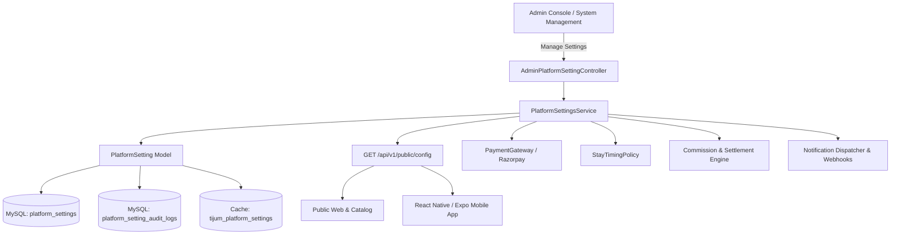

# TIJUM — Platform Settings Management System
## Centralized Configuration Architecture & Integration Guide

### 1. Architectural Overview
The **TIJUM Platform Settings Management System** provides a centralized, database-backed single source of truth for platform-wide business parameters, legal compliance, brand identity tokens, search engine configurations, API provider credentials, and operational switches.

Administrators no longer need to edit source code, manually touch environment configuration files, or trigger deployment pipelines simply to update operational timings, brand assets, tax rates, contact coordinates, or third-party integration keys.

---

### 2. Database Schema & Persistence

#### `platform_settings` Table
* `id` (bigint, PK)
* `key` (varchar 128, unique, indexed): Dot-notated identifier (e.g. `timings.check_in_time`, `integrations.razorpay_key_id`)
* `group` (varchar 64, indexed): Settings domain partition (`general`, `brand`, `seo`, `integrations`, `timings`, `financial`, `grievance`, `notifications`, `localization`, `security`, `features`)
* `value` (json, nullable): Scalable JSON payload supporting typed values and complex structures
* `is_secret` (boolean, default false): Flags confidential API credentials requiring AES encryption and frontend masking
* `is_public` (boolean, default false): Flags settings eligible for exposure via public configuration endpoints
* `data_type` (varchar 32, default 'string'): `string`, `integer`, `boolean`, `json`, or `encrypted`
* `description` (text, nullable): Administrative context and purpose
* `updated_by_admin_id` (foreignId to `admins`, nullable): Tracks last modifying staff user
* `timestamps` (`created_at`, `updated_at`)

#### `platform_setting_audit_logs` Table
* `id` (bigint, PK)
* `key` (varchar 128, indexed)
* `group` (varchar 64, indexed)
* `old_value` (json, nullable): Masked for secret keys
* `new_value` (json, nullable): Masked for secret keys
* `admin_id` (foreignId to `admins`, nullable)
* `ip_address` (varchar 45, nullable)
* `user_agent` (text, nullable)
* `created_at` (timestamp)

---

### 3. Setting Domains & Configuration Inventory

| Domain | Group | Public? | Description & Key Parameters |
| :--- | :--- | :---: | :--- |
| **Platform Info** | `general` | Yes | Brand name, legal entity name, website URL, support email/phone, headquarters address, tagline, description |
| **Brand Assets** | `brand` | Yes | Primary/horizontal/light/dark logos, mobile icon, favicon, OG share banner, email banner, Plum/Peach/Cream color tokens |
| **SEO & Search** | `seo` | Yes | Default title, meta description, canonical URL base, OG site name, Twitter handle, robots.txt, Google/Bing verification |
| **API Integrations**| `integrations` | No | Razorpay mode & keys (encrypted), WhatsApp Cloud API phone/tokens (encrypted), DLT SMS headers, Maps key (encrypted) |
| **Operational Timings**| `timings` | Yes | Standard check-in (09:00), check-out (08:00), early arrival (07:00), **15-min booking inventory hold** |
| **Financial & Tax** | `financial` | Mixed | Legal name, GSTIN, SAC (998552), default commission (1200 bps), GST on commission (1800 bps), TDS (10 bps), payout hold (24h) |
| **Grievance & SLA** | `grievance` | Yes | Statutory Nodal Officer name, title, email, hotline, physical address, 48h acknowledgement SLA, 30d resolution SLA |
| **Notification Channels**| `notifications` | No | In-app, Email, SMS (MSG91), WhatsApp (Meta Cloud API), Push (Expo) channel activation flags |
| **Localization** | `localization`| Yes | Asia/Kolkata timezone, India, INR / ₹, DD/MM/YYYY date formatting, 12-hour time, Indian Lakhs numbering |
| **Security & Access**| `security` | No | Inactivity timeout (120m), lockout threshold (5 attempts), lockout cooldown (15m), mandatory Admin 2FA, rate limits |
| **Platform Features**| `features` | Yes | Maintenance mode & message, customer registration switch, partner onboarding switch, instant booking engine |

---

### 4. Security & Cryptographic Isolation

1. **Encrypted Secret Storage**:
   * Third-party secrets (`razorpay_key_secret`, `whatsapp_access_token`, `sms_auth_key`, `google_maps_api_key`) are encrypted at rest using Laravel's `Crypt::encryptString` before insertion.
2. **Frontend UI Masking**:
   * In the Admin Console (`AdminPlatformSettingsIndex`), secrets are masked (`••••••••••••••••3a9f`).
   * When an administrator submits an update without entering a new password, the existing encrypted secret is preserved intact.
3. **Public API Allowlisting**:
   * The public configuration endpoint (`GET /api/v1/public/config`) enforces a strict allowlist from `PlatformSetting::getPublicConfig()`.
   * **Zero private settings or secret credentials are ever exposed** to public web clients or mobile bundles.

---

### 5. Multi-Platform Integration

#### 1. Backend Payment & Settlement Engine
* `AppServiceProvider`: Binds `PaymentGateway` and `RazorpayRouteService` to read active credentials from `PlatformSetting` before falling back to static config files.
* `CommissionCalculationService`: Reads commission GST rates dynamically from `financial.commission_gst_rate_bps`.
* `SettlementCalculationService`: Uses `financial.hold_interval_hours` to enforce partner payout eligibility delays.
* `CreateReservation`: Uses `timings.checkout_expiry_minutes` (authoritative 15 minutes) for booking payment locks.

#### 2. Public Web & Portals
* Public layouts, footers, meta tags, and contact pages consume platform brand assets, legal details, and support phone/emails dynamically.
* Customer protection and grievance pages display the statutory Grievance Officer details directly from database settings.

#### 3. React Native Mobile App (`apps/mobile/`)
* Calls `PublicApi.getConfig()` (`GET /api/v1/public/config`).
* Receives currency formatting (`INR`, `₹`), brand colors, support coordinates, stay timing policies, and feature flags dynamically.
