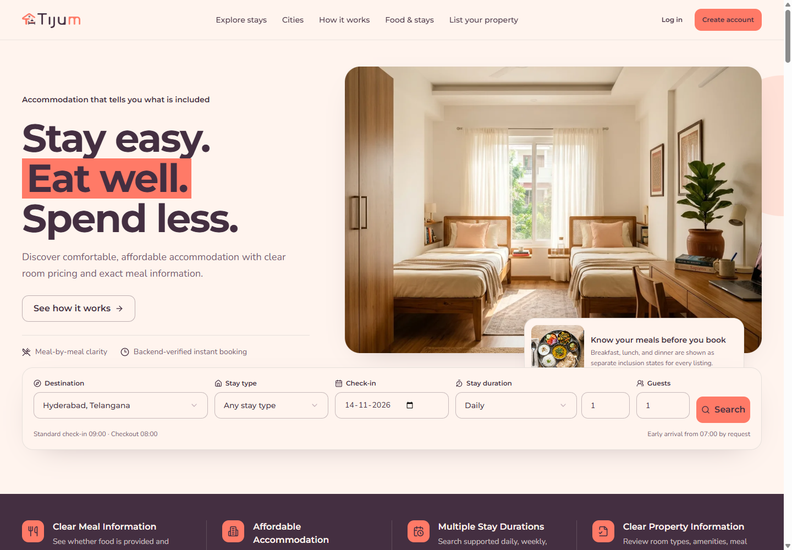
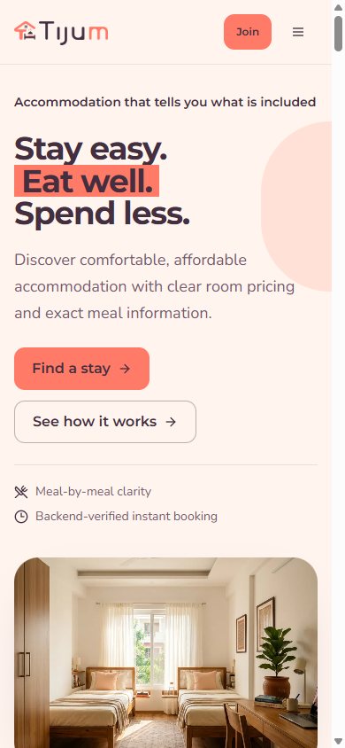
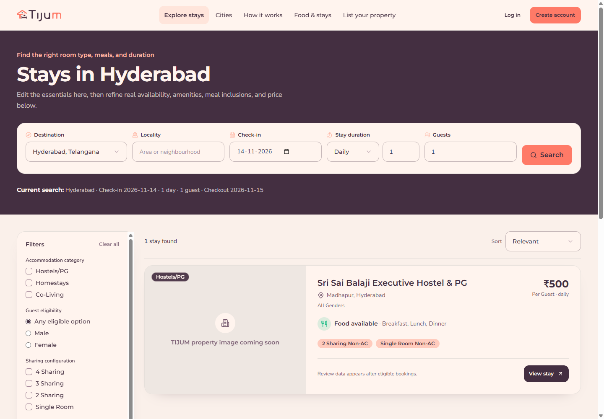
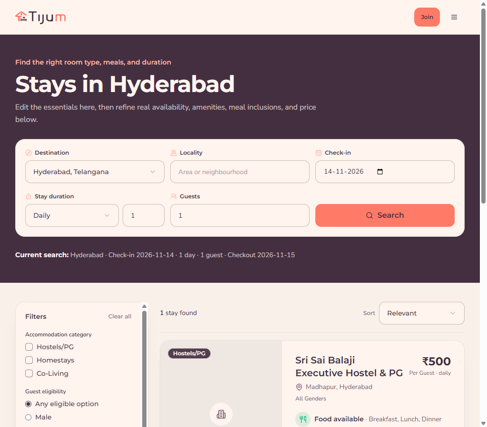
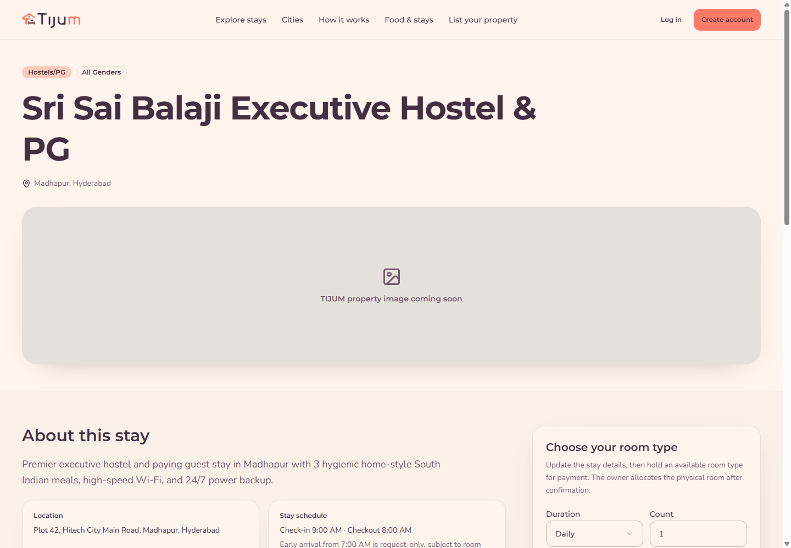
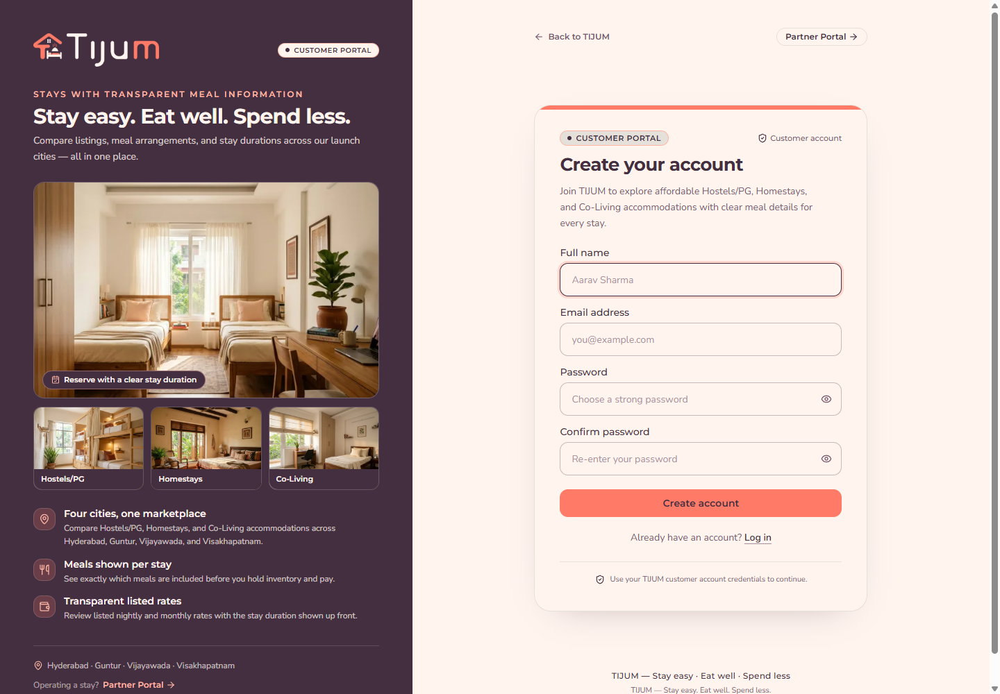
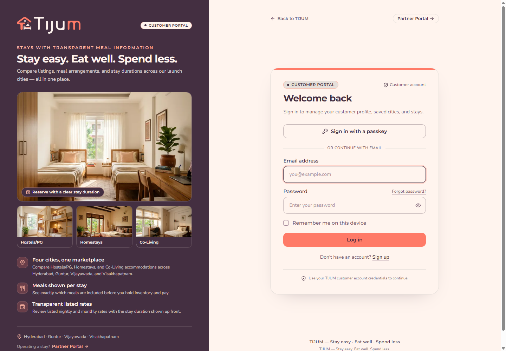

# TIJUM Website Redesign Completion Report

## Completion Status

The customer-facing TIJUM website has been redesigned as a warm, editorial accommodation marketplace while preserving the existing Laravel, Inertia, Wayfinder, reservation, payment, review, and authentication behavior.

Page-level owner/admin/mobile application redesigns were intentionally excluded. Shared web primitives inherit several brand-token and accessibility improvements, but no internal portal workflow or mobile screen was restructured.

## Design Direction

The redesign treats photography, room-type clarity, and meal transparency as the primary trust signals.

- Cream is the principal page surface.
- Deep Plum carries identity, headings, navigation, and footer structure.
- Coral is the action and emphasis color.
- Soft Peach creates restrained editorial accents.
- Muted Lavender remains a supporting token; readable secondary text uses a darker brand-only Plum/Lavender mix for WCAG contrast.
- Food Emerald appears only when an actual food or meal flag is positive.
- Montserrat is used for headings, UI, prices, buttons, and labels.
- Nunito is used for body copy, guidance, and long-form content.

The complete token rationale is in [`DESIGN.md`](../../DESIGN.md) and [`TIJUM_WEBSITE_DESIGN_SYSTEM.md`](./TIJUM_WEBSITE_DESIGN_SYSTEM.md).

## Original Problems Addressed

- The original hero put a dense form before the strongest image and had weak visual hierarchy.
- Desktop navigation and the footer carried too many competing links and placeholder policy content.
- Mobile inherited compressed desktop patterns instead of a deliberate touch flow.
- Repeated equal card grids made the homepage visually monotonous.
- Property cards duplicated markup across search and city pages.
- Food copy frequently collapsed independent meal flags into broad claims.
- Static copy still described an obsolete no-payment phase.
- City cards received backend-generated fallback ratings and prices that were not trustworthy.
- Several public pages wrapped `PublicLayout` twice.
- Customer authentication used fabricated proof claims, unrelated colors, gradients, and emoji-like content.
- Public newsletter forms enabled marketing consent without a separate unchecked control.
- `PublicSeoHead` ignored the backend `robots` directive.
- Legacy CMS image URLs produced broken images.

## New Visual System

- Added root [`DESIGN.md`](../../DESIGN.md) as the visual source of truth.
- Added the exact Food Emerald token `#10B981` for positive food states only.
- Standardized 48px primary controls, 12px control radii, 20px content-card radii, and 28px editorial image panels.
- Added Plum-tinted elevation tokens and reduced-motion behavior.
- Added accessible focus rings, selection colors, skip navigation, and brand-safe semantic status colors.
- Added a 1440px wide editorial container and a 1200px standard content container.
- Added accessibility-safe secondary text treatment using only TIJUM brand colors.

## Routes Redesigned

### Public Marketplace

- `/`
- `/search`
- `/properties/{property:slug}`
- `/hostels-in-{citySlug}`
- `/how-it-works`
- `/about`
- `/become-a-partner`
- `/faqs`
- `/blog`
- `/blog/category/{category:slug}`
- `/blog/{article:slug}`
- `/p/{slug}`
- `/review-policy`
- `/grievance-redressal`
- Newsletter subscribe/unsubscribe presentation

`/sitemap.xml` and `/robots.txt` remain non-visual endpoints; route behavior was verified.

### Customer Experience

- Login, registration, password recovery/reset, verification, password confirmation, and two-factor challenge through the new customer-only auth shell
- Customer dashboard
- Profile, security, appearance, notifications, and consent settings
- Reservation hold, detail, payment-window, confirmation, receipt, and history surfaces
- Customer notifications
- Reviews and review reporting
- Support case list, detail, and acknowledgement surfaces

## Homepage Redesign

- New split editorial hero with a large approved local room photograph.
- Mobile-first “Find a stay” action and compact desktop search surface.
- Real city, category, date, duration, and guest query behavior preserved.
- Deep Plum value band instead of another boxed card row.
- Asymmetric category and destination compositions.
- Six-step booking timeline: discover, compare, start the 15-minute inventory hold, pay, receive backend-verified automatic confirmation, and prepare for arrival.
- Dedicated food section explaining four independent flags.
- Separate trust section using real platform behavior instead of testimonials or fabricated metrics.
- Arrival timeline preserving 09:00 check-in, 08:00 checkout, 07:00 earliest requested arrival, and no fee.
- Property-owner acquisition section using the existing registration route.
- Explicit, unchecked newsletter marketing consent.
- New closing conversion section and route-safe footer.

## Marketplace Redesign

- Added one reusable `PropertyCard` for search and city previews.
- Added one reusable `FoodInclusionStatus` with independent food/breakfast/lunch/dinner states.
- Added a shared `SearchPanel` for homepage and results editing.
- Search filters preserve existing query parameters and backend behavior.
- Price filter input is shown in INR and converted to integer minor units without using floating-point pricing calculations.
- Property detail no longer calculates a reservation total in the browser; the backend quote remains authoritative.
- Room type, quantity, duration, rates, amenities, and physical-room allocation language are explicit.
- Empty property images use a branded placeholder rather than fictional stock photography.
- City cards omit backend fallback ratings/prices and direct customers to strict live search for eligibility.
- Review labels now use “Verified Booking.”

## Components Created or Refactored

- `PublicLayout`
- `CustomerAuthShell`
- `SearchPanel`
- `PropertyCard`
- `FoodInclusionStatus`
- `SectionHeading`
- `TaglineReveal`
- `FoodStorySection`
- `TrustSection`
- `NewsletterSection`
- `PublicSeoHead`
- `ResponsiveContainer`
- `Button`, `Input`, `Select`, `Badge`, `Card`, breadcrumbs, sidebar controls, and review components

## Responsive Implementation

The critical pages were inspected at:

| Viewport | Result |
|---:|---|
| 360px | Passed, no horizontal overflow |
| 390px | Passed, no horizontal overflow |
| 430px | Passed, no horizontal overflow |
| 768px | Passed |
| 1024px | Passed |
| 1280px | Passed |
| 1440px | Passed |
| 1920px | Passed |

The width matrix covered homepage, search results, property detail, login, and registration. City, about, how-it-works, FAQs, partner, blog, review policy, and grievance pages were also checked at 390px and 1440px.

Verified interactions:

- Mobile navigation opens with focus inside the dialog, closes with Escape, and restores focus to the trigger.
- Homepage search submits supported parameters and reaches results.
- Mobile filter drawer opens, remains within the viewport, closes with Escape, and preserves search behavior.
- Property detail updates duration/quantity through the existing route and keeps the booking-review action available.
- Unauthenticated reservation entry redirects to the real customer login route.
- Selects and drawers preserve the 1425px desktop client width before, during, and after opening; the measured interaction CLS is `0`.

## Second-Pass Visual QA Corrections

The redesign received a complete second visual audit after the initial completion pass. It fixed issues that first-viewport checks did not expose:

- Added a stable root scrollbar gutter and removed duplicate scroll-lock margin compensation, eliminating the select/drawer page shake.
- Removed the mobile category image `h-full` rule that clipped category titles, descriptions, and actions outside their cards.
- Added physical spacing between animated tagline words so punctuation and following words cannot join.
- Moved `PageHeader` badges onto their own row instead of appending them to long page titles.
- Delayed one-row search layouts until `xl`; 1024px now uses balanced rows without clipped city, category, or locality text.
- Constrained the desktop filter sidebar to the available viewport with independent scrolling, removing the large empty results-page column.
- Replaced customer-facing Unicode arrows and stars with Lucide `ArrowRight` and `Star` components.
- Reworked support, notification, form, and shared state surfaces to use the TIJUM palette consistently.
- Audited login, registration, forgot-password, reset-password, confirm-password, verification, and two-factor source through the shared customer auth system.

## Before and After Evidence

### Homepage Desktop

Before:

After:

### Homepage Mobile

Before:

After:

Mobile category cards after clipping fix:

### Search Results

Before:

After:

Small-laptop search reflow:

### Property Detail

Before:

After:

### Customer Authentication

### Reservation Entry

The authenticated reservation form could not be captured without automating credentials. The genuine unauthenticated reservation entry and redirect were captured instead:

## Functionality Preserved

- Laravel named routes and route model binding
- Wayfinder route generation
- Inertia props, navigation, and form submissions
- Search validation, filters, sorting, pagination, and query parameters
- Property, room-type, and owner-allocated physical-room inventory model
- Integer-paise backend pricing
- Independent food flags
- Immediate 15-minute inventory hold after booking submission
- Automatic confirmation after backend-verified captured payment
- Backend-authoritative payment verification
- Four reservation statuses: awaiting payment, confirmed, cancelled, and expired
- Review eligibility/moderation
- Fortify authentication, passkeys, password reset, verification, and two-factor authentication
- Explicit marketing consent separate from transactional preferences

## Technical Verification

| Check | Exact result |
|---|---|
| `npm run types:check` | Passed, 0 TypeScript errors |
| `npm run build` | Passed, 2,618 modules transformed |
| Build CSS | 194.17 kB, 27.99 kB gzip |
| Main app JS | 345.43 kB, 65.98 kB gzip |
| Relevant PHPUnit suite | 158 passed, 1,225 assertions |
| `npm audit --audit-level=high` | 0 vulnerabilities |
| Route list | 389 application routes registered |
| Scoped `vp check --deny-warnings` | Passed for redesigned files |
| Static accessibility audit | 0 issues in 55 public, auth, customer, reservation, settings, support, and customer-component files |
| Axe WCAG audit | 0 violations on 15 audited public/auth routes, including forgot-password and reset-password |
| Browser console | 0 errors on final critical-page navigation |
| Broken images | 0 on inspected public routes |
| Select/drawer layout stability | Client width unchanged; measured interaction CLS `0` |

The first SEO regression test run found the Inertia robots key mismatch (`meta-robots` versus `robots`). It was corrected and the complete relevant suite subsequently passed.

## Remaining Defects and Constraints

### Backend Defects Identified, Not Changed

- City landing data bypasses the stricter search-eligibility service and still contains backend fallback editorial/property/SEO values. The redesigned UI removes fallback ratings/prices, omits the unverified structured data, and points customers to live search, but the controller should be corrected separately.
- Several public/API serializers reference non-existent or mismatched columns, including legacy price, image, currency, timestamp, and reservation-code fields.
- Failed webhook event IDs are not automatically retry-safe, and webhook capture does not match checkout verification’s amount/currency validation.
- Payment/refund and cancellation-policy frontend contracts do not fully match backend payload shapes.
- Sitemap city slug generation, eligibility filtering, and cache invalidation require backend corrections.
- Search minimum and maximum price semantics differ between eligibility and customer-data layers.

These are documented rather than silently expanded into a backend redesign.

### Verification Constraints

- Browser tooling was not used to automate authentication credentials. Authenticated dashboard/reservation interfaces are covered by TypeScript, feature tests, shared-layout rendering, and static checks, but no logged-in screenshot was captured.
- The excluded owner portal still contains legacy text describing incoming reservation requests and owner action, although the corrected backend now confirms bookings automatically after payment. Those internal owner screens were not changed because the redesign scope excludes the owner portal.
- Project-wide `vp check --deny-warnings` still reports formatting issues in 118 pre-existing files, primarily the excluded React Native, admin, and owner areas. The redesigned scope passes the same checker with warnings denied.

## Final Assessment

The customer website now presents TIJUM as a coherent hospitality marketplace rather than a dense listing directory. Search is direct, photography carries the first impression, room-type pricing remains backend-led, meal states are unmistakable, and customer/account surfaces share the same brand system without changing business logic.
